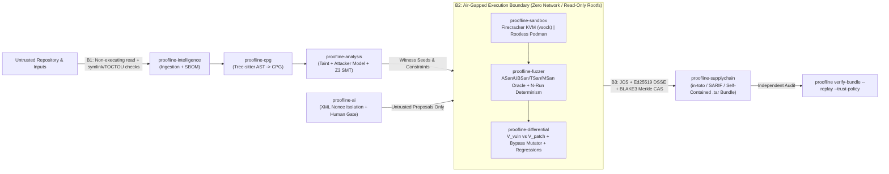

# Project Proofline

[](https://github.com/NeuralCrafter0/Rust-Compile/actions/workflows/ci.yml)
[](LICENSE)
[](Cargo.toml)

**Evidence-grounded software security verification, deterministic vulnerability reproduction, differential patch verification, and cryptographically signed attestation bundles.**

> *Claim != Fact; Alert != Vulnerability; Test Passes != Security Verified*

Project Proofline replaces probabilistic static alerts and shallow test-passing assumptions with reproducible, cryptographically bound verification artifacts. Given an untrusted source repository, a reported bug or reproducer, and a candidate patch, Proofline isolates execution inside air-gapped **Firecracker KVM microVMs** or **rootless Podman containers**, traces **Tree-sitter Code Property Graphs**, solves AST-extracted constraints with **Z3**, verifies behavior differentially (`V_vuln` vs `V_patch`), hunts for encoding and boundary bypasses, and packages results into independently replayable **Ed25519 / in-toto v1.0 / BLAKE3 Evidence Bundles**.

---

## Why Proofline Exists

- **Static scanners drown teams in unverified alerts**: Proofline separates heuristic hypotheses (`StaticallyTainted`) from solver-backed reachability (`SymbolicallySatisfiable`) and deterministic sandbox crashes (`ConfirmedReproduced`).
- **Fixes often block only the demo PoC**: `DifferentialVerificationEngine` runs adversarial mutation variants (`..%2f`, `..%252f`, `..;/`, `/**/`, `${IFS}`, embedded NUL bytes) against `V_patch` and checks golden regression outputs for silent `exit 0` semantic drift.
- **Analyzing hostile repositories puts developer and CI machines at risk**: `IngestionEngine` rejects resolving/dangling symlink escapes and TOCTOU swaps without executing build scripts (`Makefile`, `build.rs`, `setup.py`), while `proofline-sandbox` enforces network-denied microVM/container execution and ANSI trace sanitization.
- **Third-party auditors need independent replay**: Every verification verdict can emit a deterministic `.tar` Evidence Bundle containing signed `in-toto` provenance, CAS digests, SARIF v2.1.0, sanitized traces, and self-contained replay harnesses (`verify-bundle --replay`).

---

## System Architecture & Trust Boundaries



For formal boundary guarantees and threat models, see [RFC-001](docs/rfcs/0001-threat-model-system-boundaries-verification-contract.md) and [Isolation Model](docs/architecture/isolation-model.md).

---

## Epistemic Confidence Tiers

Proofline forbids conflating static guesses, solver models, and empirical proof. Every finding carries an explicit `EpistemicTier`:

| Tier | Verification Requirement |
| :--- | :--- |
| `ConfirmedReproduced` | Concrete reproducer deterministically triggers `CrashOracle` across `N/N` clean isolated sandbox runs (`N >= 1`). |
| `SymbolicallySatisfiable` | Path condition parameterized from AST bounds solved `sat` by Z3 / bounded native solver. |
| `StaticallyTainted` | Interprocedural `DataFlow`/`CallEdge` path connects `SecurityIngress` to `SecuritySink` without a dominating `SanitizerGuard`. |
| `HeuristicHypothesis` | Initial ceiling assigned to unverified patterns or AI-generated proposals (`AiHypothesisProposal`). |
| `VerifiedMitigation` | Original reproducer crashes `V_vuln`, fails to crash `V_patch`, survives `AdversarialMutator` variants, and preserves golden regression outputs. |
| `Inconclusive` | Timed out, non-deterministic across replay runs, or exhibited semantic invariant drift on regressions (`Err` / fail-closed). |

---

## Workspace Crates

| Crate | Responsibility |
| :--- | :--- |
| [`proofline-core`](crates/proofline-core) | `EpistemicTier`, `VerificationContract` (`PVC-*`), tamper-evident `EvidenceBundle`, fail-closed errors, ANSI CSI/OSC trace sanitizer |
| [`proofline-intelligence`](crates/proofline-intelligence) | Zero-trust repository ingestion, symlink traversal & TOCTOU size guards, safe `.git/HEAD` resolution, manifest/framework detection, root `BLAKE3` hashing |
| [`proofline-sandbox`](crates/proofline-sandbox) | Air-gapped `FirecrackerSandboxRunner` (`/dev/kvm` + `virtio-vsock`), `proofline-guest-agent`, `stage_workspace_files`, hardened `PodmanSandboxRunner`, and `AdaptiveSandboxRunner` |
| [`proofline-cpg`](crates/proofline-cpg) | Multi-file interprocedural `CodePropertyGraph` (`ProjectCpgBuilder`) powered by **Tree-sitter** across all 6 languages: **C, Python, Rust, JS/TS, Go, and Java** |
| [`proofline-analysis`](crates/proofline-analysis) | Interprocedural taint reachability, `ExploitabilityEvaluator`, AST-extracted C array/ingress constraint synthesis, and `Z3` / bounded native SMT solving (`SmtSolverBackend`) |
| [`proofline-fuzzer`](crates/proofline-fuzzer) | Stderr-only `CrashOracle` (ASan/LSan/TSan/MSan/UBSan/signals/panics), N-run determinism (`ReproducerSynthesizer`), `MutationFuzzer`, and `SanitizedBuildPipeline` |
| [`proofline-differential`](crates/proofline-differential) | Dual-branch `V_vuln` vs `V_patch` execution, `AdversarialMutator` encoding/SQLi/CMDi/NUL bypass discovery, and stdout-digest regression invariance |
| [`proofline-supplychain`](crates/proofline-supplychain) | Ed25519 DSSE signing, RFC 8785 JCS canonicalization, in-toto v1.0 & SLSA v1.0 provenance, `TrustedIdentityPolicy`, OASIS SARIF v2.1.0, CycloneDX 1.5 SBOM, deterministic USTAR archives, Merkle CAS bundles & replay, bit-for-bit build diffing |
| [`proofline-ai`](crates/proofline-ai) | Non-oracle AI boundary: CSPRNG random-nonce XML isolation, `AiVerificationGate`, mandatory human approval gate (`auto_push_permitted = false`), BLAKE3 hash-chained audit trail |
| [`proofline-cli`](crates/proofline-cli) | Unified `proofline` CLI binary supporting `--sandbox <podman\|firecracker\|auto>` across fuzzing, patch verification, and replay |

---

## Building & Provisioning

### Build & Test (Standard Linux / Alpine Container)

On hosts with standard C/glibc headers:

```bash
cargo test --workspace --locked
cargo build --release --workspace --locked
```

Inside the pinned `rust:alpine` container via rootless Podman:

```bash
podman run --rm \
  -v "$(pwd):/workspace:Z" \
  -v "$HOME/.cargo/registry:/usr/local/cargo/registry:Z" \
  -w /workspace \
  docker.io/library/rust:alpine \
  cargo test --workspace --offline
```

### Hermetic Sandbox Image (`clang` + ASan/UBSan + `z3`)

Build the local analysis container image ([scripts/Containerfile.sandbox](scripts/Containerfile.sandbox)):

```bash
podman build -t localhost/proofline-sandbox:latest -f scripts/Containerfile.sandbox .
```

### Air-Gapped Firecracker KVM Rootfs (`/dev/kvm`)

Place `firecracker` (`v1.18.0`+) and `vmlinux-6.1.102` under `$HOME/.local/share/proofline/firecracker/` (or set `PROOFLINE_FIRECRACKER_DIR`), build the release guest agent, and assemble an immutable 64 MiB Alpine `ext4` rootfs containing `/sbin/init` and `proofline-guest-agent`:

```bash
./scripts/build-guest-rootfs.sh
```

---

## CLI Reference & Quickstart

```bash
# 1. Inspect an untrusted repo safely (zero build-script execution) and emit a CycloneDX 1.5 SBOM
proofline inspect ./path/to/repo --sbom sbom.cdx.json --json

# 2. Construct a Tree-sitter CPG, solve AST-extracted path constraints with Z3, and emit SARIF v2.1.0
proofline analyze ./src/handler.c --sarif report.sarif.json
proofline analyze-repo ./path/to/repo --sarif repo.sarif.json

# 3. Generate an Ed25519 keypair (private key written 0600)
proofline keygen --out-dir ./keys

# 4. Fuzz-reproduce a vulnerability (`--sandbox podman | firecracker | auto`)
proofline reproduce \
  --workdir ./target-repo \
  --seed ./seed.bin \
  --sandbox firecracker \
  --budget 64 \
  --runs 3 \
  --out-poc ./poc.bin \
  -- /workspace/target_vuln

# 5. Differentially verify V_vuln vs V_patch and package a self-contained signed Evidence Bundle
proofline verify-patch \
  --workdir ./target-repo \
  --vuln-cmd /workspace/vuln_bin \
  --patch-cmd /workspace/patch_bin \
  --reproducer ./poc.bin \
  --regression ./healthy_req.json \
  --sandbox auto \
  --image localhost/proofline-sandbox:latest \
  --signing-key ./keys/proofline.key.json \
  --bundle-out ./evidence.tar \
  --sarif-out ./verification.sarif.json \
  --markdown-out ./summary.md

# 6. Cryptographically verify, policy-check, and independently replay an Evidence Bundle
proofline verify-bundle \
  --bundle ./evidence.tar \
  --pubkey ./keys/proofline.pub.json \
  --trust-policy ./trust-policy.json \
  --replay \
  --sandbox firecracker

# 7. Validate verification contracts or diff two builds bit-for-bit
proofline verify-contract --contract ./tests/integration/sample-contract.json
proofline verify-builds ./build-a/app ./build-b/app --json
```

---

## Empirical Verification & Upstream Evaluations

All results below reflect observed runs documented in [Benchmarking Methodology](docs/evaluation/benchmarking-methodology.md):

| Evaluation Target | Scope & Environment | Observed Outcome |
| :--- | :--- | :--- |
| **Workspace Test Suite** | `cargo test --workspace --offline` (`rust:alpine`) | **57 tests passed**, `0` failed across all 10 crates (`proofline-cpg`: 7, `proofline-analysis`: 10, `proofline-sandbox`: 7 unit + KVM live test, `proofline-fuzzer`: 6, `proofline-differential`: 3, `proofline-intelligence`: 8, `proofline-supplychain`: 5, `proofline-ai`: 3, `proofline-core`: 2, `proofline-cli`: 5). |
| **Live Firecracker KVM + CLI Staging** | Host `/dev/kvm` + `Firecracker v1.18.0` + `vmlinux-6.1.102` | Sequential VM roundtrips verified `lo`-only networking, read-only `/`, ANSI stripping, fault code propagation (`0.52s`), `reproduce --sandbox firecracker`, `verify-patch --sandbox firecracker`, and zero-override `verify-bundle --replay --sandbox firecracker` (`matches_attestation=true`). |
| **Upstream `DaveGamble/cJSON` `#1065`** (`fb16e5cf` -> `6d9f2443`) | `clang 17.0.6 -fsanitize=address,undefined` inside `--network=none` `localhost/proofline-sandbox:latest` | Reproduced `AddressSanitizer: heap-use-after-free` (`3/3` runs) on `V_vuln`; proved `VerifiedMitigation` on `V_patch` (`3` bypass mutations, `0` regressions); signed `EVD-2026-F590A49906F34297B330AF150C1CD1E4` verified against `TrustedIdentityPolicy`. |
| **Upstream `DaveGamble/cJSON` `#984`** (`a29814f2` -> `5cc0e39f`) | Same ASan+UBSan sandbox (1 MiB stack limit, depth `150000`) | Caught incomplete upstream fix: `V_patch` stopped inside `cJSON_PrintUnformatted` (`printed=0`) **but still overflowed the stack inside `cJSON_Delete`**; rejected `VerifiedMitigation` (`ConfirmedReproduced`, CLI exit `2`). |
| **Live SMT Solving (`Z3 4.13.0`)** | `proofline analyze` inside `localhost/proofline-sandbox:latest` | Solved AST-extracted `char dst[16]` / `fgets(..., 512, ...)` path constraints to `EpistemicTier::SymbolicallySatisfiable`. |

---

## Explicit Non-Goals & Known Boundaries

- **Not a universal correctness prover**: Passing differential verification proves mitigation against the attested reproducer, bounded adversarial mutation budget, and golden regressions—not mathematical absence of all bugs.
- **Static scope boundaries**: All 6 language frontends use Tree-sitter ASTs, while cross-language FFI lowering (`ctypes`, `extern "C"`) and static C `free -> use` heap-lifetime typestate are not yet modeled statically (heap UAFs rely on dynamic ASan reproduction).
- **Coverage & external integrations**: `MutationFuzzer` currently uses deterministic black-box byte mutations rather than `SanitizerCoverage` / `libFuzzer` feedback; `proofline-ai` has no CLI LLM HTTP driver wired; `HermeticProxyOnly` fails closed until an explicit proxy sidecar is provided; and `RekorInclusionMetadata::validate_binding` performs offline structural/digest validation rather than live Sigstore Merkle inclusion checks.

---

## Documentation, Governance & Schemas

- **Architecture & Decisions**: [RFC-001](docs/rfcs/0001-threat-model-system-boundaries-verification-contract.md), [Isolation Model](docs/architecture/isolation-model.md), [Evidence Specification](docs/architecture/evidence-specification.md), [ADR-0001](docs/adr/0001-rust-workspace-and-sandbox-isolation.md), [ADR-0002](docs/adr/0002-deterministic-ustar-and-ed25519-dsse.md), [ADR-0003](docs/adr/0003-epistemic-confidence-tiers-and-ai-boundary.md)
- **Research & Benchmarking**: [Literature Review](docs/research/literature-review.md), [Benchmarking Methodology](docs/evaluation/benchmarking-methodology.md), [Changelog](CHANGELOG.md)
- **Schemas**: [`verification-contract`](schemas/verification-contract.schema.json), [`evidence-bundle`](schemas/evidence-bundle.schema.json), [`attestation-statement`](schemas/attestation-statement.schema.json), [`code-property-graph`](schemas/code-property-graph.schema.json)
- **Governance**: [Security Policy](SECURITY.md), [Contributing Guide](CONTRIBUTING.md), [Apache-2.0 License](LICENSE)
